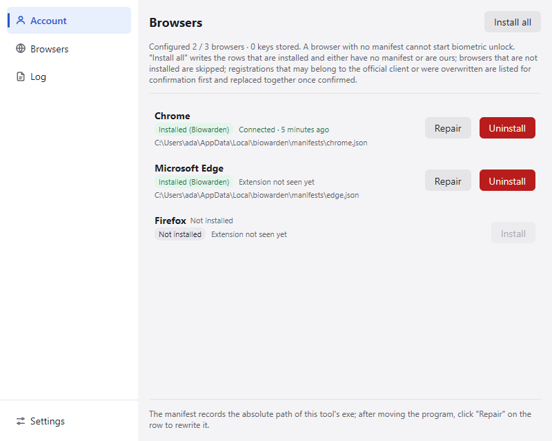
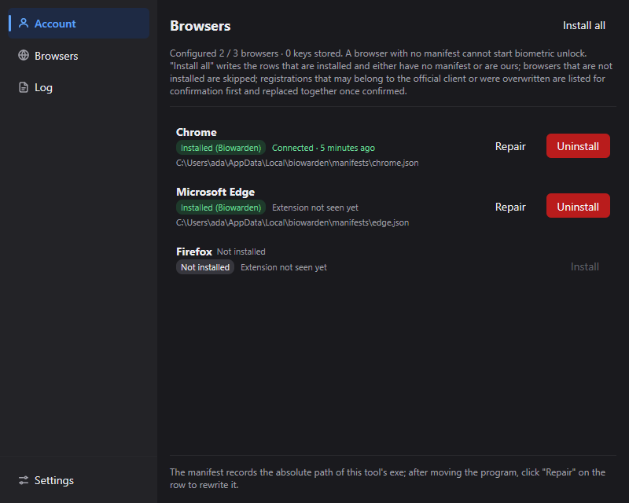

# Biowarden

[](https://github.com/windedge/biowarden/releases)
[](./LICENSE)

English · [简体中文](./README.zh-CN.md)

Biometric unlock for the Bitwarden browser extension on Windows - one small exe instead of the
Bitwarden Desktop app. Sign in inside Biowarden, and Windows Hello gates the account key. Dark and
light appearances, seven interface languages, no account key ever written in plain text.
Not an official Bitwarden project; please don't report unlock problems to the Bitwarden team.

**Windows Hello gates *access* to the key, it does not encrypt it.** The key sits in the Windows
Credential Manager as raw bytes; passing the prompt only means Biowarden may read it. That is the
same model you already accept with the official desktop client.

| Light | Dark |
|---|---|
|  |  |

## Install

1. Download `biowarden-setup-<version>-amd64.exe` from
   [Releases](https://github.com/windedge/biowarden/releases) and run it (per-user install). The
   installer is the only thing published there, next to a `SHA256SUMS.txt`.
2. Check the download against it:

   ```powershell
   (Get-FileHash .\biowarden-setup-<version>-amd64.exe).Hash   # compare with SHA256SUMS.txt
   ```

   On a shell with coreutils, `sha256sum -c SHA256SUMS.txt` does the same.

3. Launch Biowarden. On a fresh machine it registers your browsers and opens the login window.

Nothing is code-signed, so first run shows SmartScreen's "Windows protected your PC": click
**More info** -> **Run anyway**. The hash check above is your guard against a tampered download.
Requires Windows 10 1709 or later with Windows Hello set up.

## Use

1. **Sign in** - email and master password in the login window. The server address is under
   **Advanced**; it defaults to the official Bitwarden cloud and accepts any self-hosted address
   (Vaultwarden included). TOTP, email and YubiKey second factors are supported; WebAuthn and Duo
   are not.
2. **Confirm with Windows Hello** - the prompt is what writes the key. Refusing stores nothing.
3. **Enable biometrics in the extension** - Settings -> Security -> "Unlock with biometrics", then
   restart the browser completely; browsers read the registration only at startup.

Lock and unlock in the extension as usual. **Log out** on the Account page deletes the stored key
and the session.

Something not working? [Troubleshooting](./docs/troubleshooting.md) starts with the three reasons
an unlock prompt never appears, before it gets to the extraction-script fallback.

## Docs

| | |
|---|---|
| [How it works](./docs/how-it-works.md) | protocol, key storage, security model, repository layout |
| [Troubleshooting](./docs/troubleshooting.md) | unlock prompt missing, extraction script, limitations, uninstall |
| [Building](./docs/build.md) | from source, packaging, releasing |
| [Security policy](./SECURITY.md) | how to report a vulnerability, what is in scope |
| [Third-party notices](./THIRD_PARTY_NOTICES.md) | licenses and the origin of ported work |
| [Contributing](./CONTRIBUTING.md) | how to report, build and send a change |

## The connection name

The host registers under `com.8bit.bitwarden`, because that name is hard-coded in the extension.
Taking that registration over is the whole cost of not forking or patching it. An existing
registration is shown as "possibly the official client" and only replaced after you confirm.

## Disclaimer

Not affiliated with Bitwarden or 8bit Solutions LLC in any way. Bitwarden is a trademark of
Bitwarden Inc.; the connection name `com.8bit.bitwarden` appears here only because the browser
extension requires that exact name. The key you store is your vault's encryption key: never keep a
plaintext copy anywhere. Use at your own risk. Released under the [MIT license](./LICENSE).
