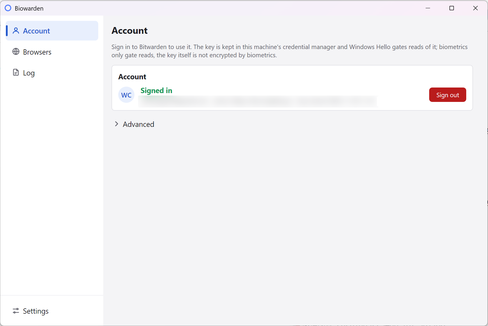

# Biowarden

[](https://github.com/windedge/biowarden/releases)
[](./LICENSE)

[English](./README.md) · 简体中文

Windows 上的 Bitwarden 浏览器扩展「生物识别解锁」独立工具 - 用一个 exe 顶替官方桌面客户端。
在 Biowarden 里登录账号，由 Windows Hello 放行账号密钥。支持深色与浅色外观、七种界面语言，
账号密钥不会以明文写入任何地方。本项目非 Bitwarden 官方项目，解锁问题请勿反馈给 Bitwarden 团队。

**Windows Hello 只放行「读取」密钥，它不加密密钥。** 密钥以原始字节存在 Windows 凭据管理器里；
通过验证只表示 Biowarden 可以去读它。这与官方桌面客户端的威胁模型一致。



## 安装

1. 从 [Releases](https://github.com/windedge/biowarden/releases) 下载
   `biowarden-setup-<版本>-amd64.exe` 运行安装（按用户安装）。Releases 上只发布安装器，另附一个
   `SHA256SUMS.txt`。
2. 用它与下载文件比对：

   ```powershell
   (Get-FileHash .\biowarden-setup-<版本>-amd64.exe).Hash   # 与 SHA256SUMS.txt 里的值对照
   ```

   在带有 coreutils 的 shell 里，`sha256sum -c SHA256SUMS.txt` 效果相同。

3. 启动 Biowarden。在干净的机器上它会自行注册浏览器并弹出登录窗。

程序未做代码签名，首次运行会出现 SmartScreen 的「Windows 已保护你的电脑」：点**更多信息** ->
**仍要运行**。上面的哈希校验就是你防篡改的手段。需要 Windows 10 1709 或更高版本，并已配置
Windows Hello。

受支持的扩展浏览器为 Chrome、Edge 与 Firefox；Brave、Vivaldi 尚未支持 - 详见
[已知限制](./docs/troubleshooting.md#known-limitations)。

## 使用

1. **登录** - 在登录窗输入邮箱与主密码。服务器地址在「高级」里，默认官方 Bitwarden 云，
   也接受任何自托管地址（含 Vaultwarden）。支持 TOTP、邮箱验证码和 YubiKey，不支持 WebAuthn 与 Duo。
2. **Windows Hello 确认** - 这个提示才是写入密钥的动作。拒绝则什么都不留下。
3. **在扩展里启用生物识别** - 设置 -> 安全 -> 「使用生物识别解锁」，然后**完整重启浏览器**；
   浏览器只在启动时读注册项。

之后在扩展里正常锁定与解锁即可。账号页的**退出登录**会删除已存密钥与会话。

解锁时弹窗不出现？[故障排查](./docs/troubleshooting.md) 开头就是三种常见原因，之后才是提取脚本兜底。

## 常见问题

### Biowarden 是 Bitwarden 官方产品吗？

不是。Biowarden 是独立项目，与 Bitwarden Inc. 无任何官方关联。`com.8bit.bitwarden` 这个名字是官方扩展写死的 appId，Biowarden 只是接管该注册表项，让扩展能找到 host - 详见[关于连接名](#关于连接名)。

### 它会上传我的密码吗？

不会。网络请求只发往你自己的 Bitwarden 服务器（或 Vaultwarden）；`internal/auth` 是唯一发起 HTTP 的包。没有遥测、没有分析，源码开放可审计。

### 为什么必须输入主密码？

Biowarden 是密码管理器的「钥匙链」：用主密码派生 userKey，再把 userKey 存进 Windows 凭据管理器。主密码本身**不落盘**（派生后即丢弃）；access token 也不落盘。只有 refresh token 会被持久化，作为 DPAPI 加密的 `Biowarden/Session/<userId>` 条目。详见[安全模型](./docs/how-it-works.md#security-model)。

### Windows Hello 加密了我的密钥吗？

没有。Hello 只放行读取 `Biowarden/<userId>` 凭据条目的权限；密钥以原始字节存在（由凭据管理器自身的 DPAPI 封装，对 OS 用户可读）。Hello 是「门卫」，不是「保险箱」。详见[安全模型](./docs/how-it-works.md#security-model)。

### 为什么不直接用官方桌面客户端？

官方客户端是完整的 Electron 应用 - 数百 MB、常驻后台进程、自动更新。Biowarden 是按需启动的 native messaging host：内存占用几十 MB、启动毫秒级、不带常驻 UI 进程（GUI 是独立进程，只在需要时打开）。适合「只用浏览器扩展」的人。

### 怎么确认安装器没被篡改？

每个 Release 都附 `SHA256SUMS.txt`；用 PowerShell 的 `Get-FileHash -Algorithm SHA256` 校验下载文件（或 `sha256sum -c`）。完整源码在 GitHub 上，CI 每次推送都会构建，在 windows-latest 上跑
`go build`、`go vet`、`go test` 与 `mygo generate`。程序未签名，SmartScreen 会警告 - 哈希校验就是你的防护。

## 文档

详细文档为英文：

| | |
|---|---|
| [工作原理](./docs/how-it-works.md) | 协议、密钥存放、安全模型、目录结构 |
| [故障排查](./docs/troubleshooting.md) | 弹窗不出现、提取脚本、已知限制、卸载 |
| [从源码构建](./docs/build.md) | 构建、打包、发版 |
| [安全策略](./SECURITY.md) | 如何报告漏洞、哪些在范围内 |
| [第三方来源](./THIRD_PARTY_NOTICES.md) | 许可证与移植来源 |
| [参与贡献](./CONTRIBUTING.md) | 如何报告、构建与提交改动 |
| [仓库地图](./docs/agents-brief.md) | 各部分在哪、改动必须保持哪些检查通过 |

## 关于连接名

host 注册在 `com.8bit.bitwarden` 名下，因为这个名字硬编码在扩展里。接管这一项注册，就是
「不用 fork 也不用改扩展」的全部代价。已经存在的注册会显示成「可能是官方客户端」，只有你确认后
才覆盖。

## 免责声明

与 Bitwarden 及 8bit Solutions LLC 无任何关联。Bitwarden 是 Bitwarden Inc. 的商标；这里出现
`com.8bit.bitwarden` 这个连接名，只是因为浏览器扩展要求必须叫这个名字。录入的密钥等同于保险库的
加密密钥，请勿在任何地方明文留存。使用风险自负。以 [MIT 许可证](./LICENSE) 发布。
